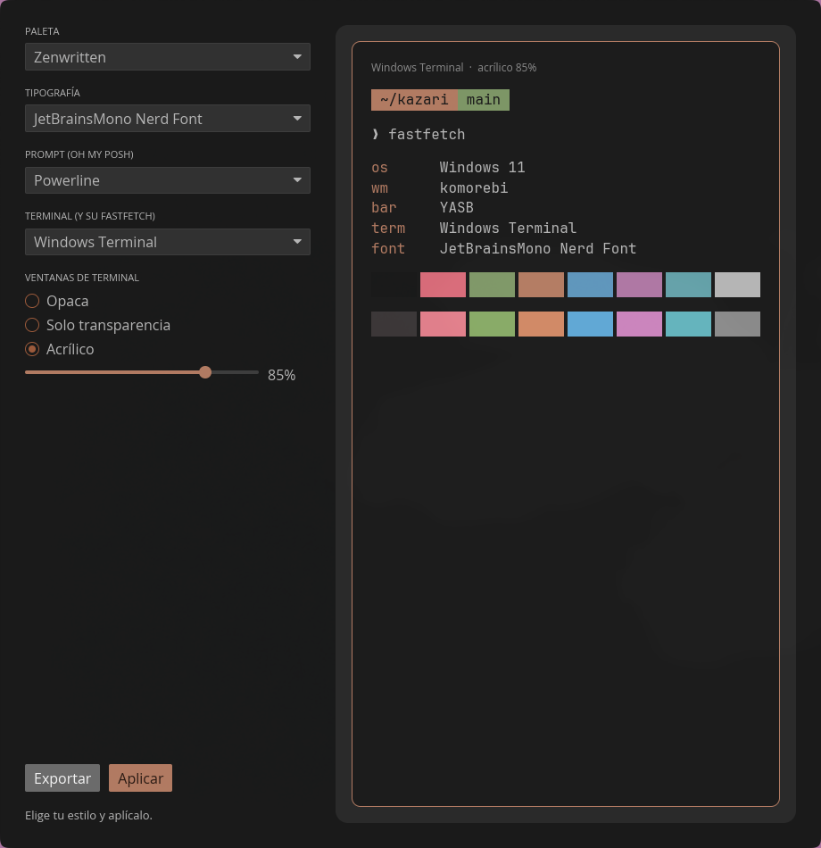

# kazari 飾り

Aplicación de escritorio en Rust para personalizar ("ricear") Windows en pocos clics: eliges una paleta, una tipografía, un estilo de prompt y el efecto de las ventanas de terminal, ves la vista previa y kazari escribe la configuración de cada herramienta.

> Proyecto personal para aprender Rust. *Kazari* (飾り) significa «adorno» en japonés.



## Qué configura

| Herramienta | Qué cambia | Archivo |
|---|---|---|
| [komorebi](https://github.com/LGUG2Z/komorebi) | Bordes de ventana con los colores de la paleta | `%USERPROFILE%\komorebi.json` |
| [YASB](https://github.com/amnweb/yasb) | Variables CSS `--kz-*` y la tipografía de la barra | `%USERPROFILE%\.config\yasb\styles.css` |
| [Oh My Posh](https://ohmyposh.dev) | Prompt en estilo Minimal, Powerline o Pills | `%USERPROFILE%\.config\kazari\kazari.omp.json` |
| [fastfetch](https://github.com/fastfetch-cli/fastfetch) | Logo y colores según la terminal que uses | `%USERPROFILE%\.config\fastfetch\config.jsonc` |
| Windows Terminal | Esquema de color, tipografía, transparencia o acrílico | `settings.json` del paquete |
| WezTerm | Módulo Lua con colores, tipografía y fondo acrílico | `%USERPROFILE%\.config\wezterm\kazari.lua` |
| Alacritty | Archivo TOML con colores, tipografía y opacidad | `%APPDATA%\alacritty\kazari.toml` |

kazari **edita** los archivos existentes en lugar de reemplazarlos: conserva tus ajustes y solo toca las claves que le corresponden. Antes del primer cambio guarda una copia `*.kazari.bak` del original.

Alacritty no tiene efecto acrílico, así que en esa terminal se aplica solo transparencia.

## Descarga

Descarga el `.zip` de la última versión desde [Releases](https://github.com/Santiago-0t/kazari/releases/latest), descomprímelo y ejecuta `kazari.exe`. No requiere instalación. El ejecutable no está firmado, así que Windows SmartScreen puede mostrar un aviso la primera vez: pulsa **Más información → Ejecutar de todas formas**.

Para comprobar que el `.zip` se compiló en este repositorio y no fue modificado, usa la [CLI de GitHub](https://cli.github.com/):

```powershell
gh attestation verify kazari-v0.1.0-windows-x86_64.zip --repo Santiago-0t/kazari
```

## Uso

1. Instala la tipografía Nerd Font que vayas a elegir.
2. Abre kazari, elige tu estilo y pulsa **Aplicar**. **Exportar** escribe los mismos archivos en `kazari-export/` sin tocar el sistema, para revisarlos antes.
3. Recarga komorebi y YASB. Para el prompt, añade a tu perfil de PowerShell:

   ```powershell
   oh-my-posh init pwsh --config "$env:USERPROFILE\.config\kazari\kazari.omp.json" | Invoke-Expression
   ```

   En WezTerm, carga el módulo desde `wezterm.lua` con `require("kazari").apply(config)`; en Alacritty, añade `[general] import = ["kazari.toml"]`.

## Arquitectura

```
crates/
├── kazari-core/   # lógica sin interfaz: paletas, generadores y escritura con copia de seguridad
│   ├── palette.rs         # Color y paletas incluidas
│   ├── rice.rs            # lo que elige el usuario (Rice)
│   ├── generators/        # una función pura por herramienta: Rice -> contenido del archivo
│   └── plan.rs            # rutas de Windows, plan de archivos y escritura
└── kazari-app/    # interfaz en iced (arquitectura Elm: estado, mensajes, update, view)
```

El núcleo no depende de la interfaz ni de Windows, así que se prueba en cualquier sistema:

```bash
cargo test -p kazari-core   # pruebas del núcleo
cargo run -p kazari         # abre la app
```

La integración continua prueba el núcleo en Linux y compila `kazari.exe` en Windows. Al subir un tag `v*` (por ejemplo `git tag v0.1.0 && git push origin v0.1.0`), el workflow `release.yml` compila el ejecutable y publica el `.zip` con su suma SHA-256 en GitHub Releases.

## Hoja de ruta

- [ ] Instalar la Nerd Font elegida automáticamente.
- [ ] Recargar komorebi y YASB al aplicar.
- [ ] Añadir Oh My Posh al perfil de PowerShell automáticamente.
- [ ] Color de acento y modo oscuro de Windows a partir de la paleta.
- [ ] Guardar y compartir presets propios.
- [ ] Restaurar las copias `*.kazari.bak` desde la app.

## Créditos

Las paletas incluidas son obra de sus autores, todas con licencia MIT:

- Zenwritten, de [zenbones.nvim](https://github.com/zenbones-theme/zenbones.nvim)
- [Catppuccin](https://github.com/catppuccin/catppuccin) Mocha
- [Gruvbox](https://github.com/morhetz/gruvbox) Dark
- [Nord](https://github.com/nordtheme/nord)
- [Tokyo Night](https://github.com/tokyo-night/tokyo-night-vscode-theme)
- [Rosé Pine](https://github.com/rose-pine/rose-pine-theme)

## Licencia

MIT. Las licencias de las dependencias incluidas en el ejecutable van en `THIRD_PARTY_LICENSES.txt` dentro de cada release.
